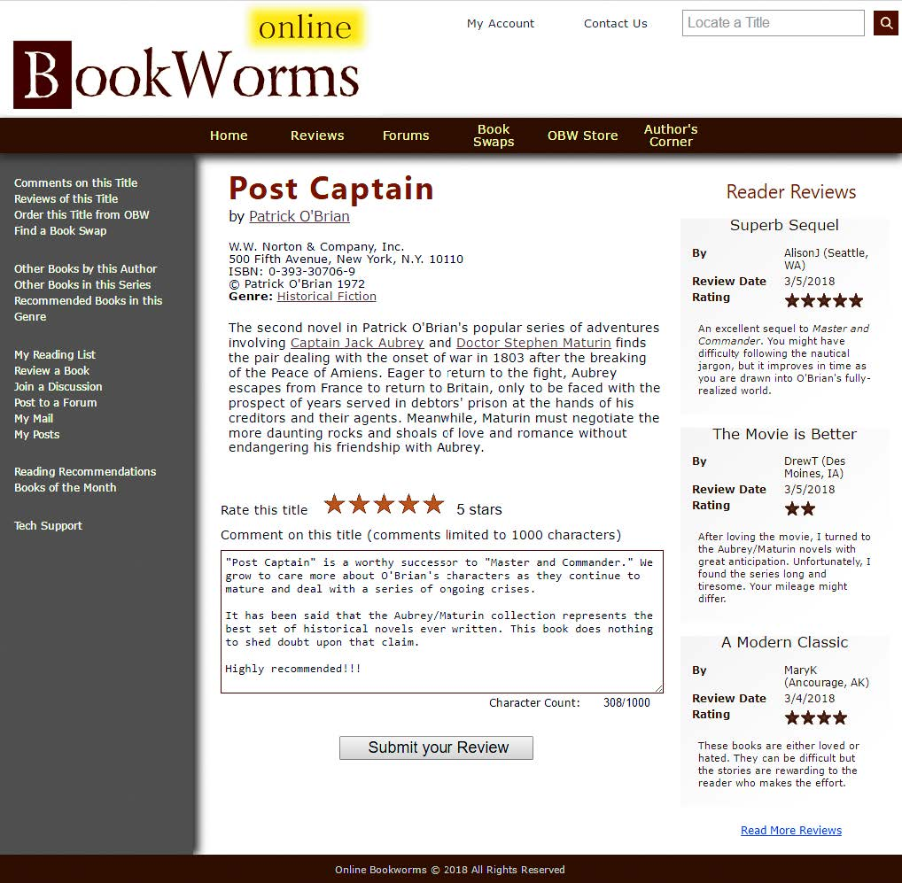

## Summary

**Online Bookworms** |Daniel Palmer is a content manager of Online Bookworms, a website dedicated to lovers of books and reading. One of Daniel’s tasks is to create a comments page in which users can enter short comments in a text area box about books they have read. To keep the comments short and to the point, Daniel wants to limit each comment to 1000 words. He asks you to write a
script that will update a character counter that shows the user how much of the 1000 characters has already been typed.

Daniel also wants users to be able to rate the books by moving a mouse pointer over a row of five stars. If the user moves the mouse pointer over the third star, the first three stars should be lit. If the user moves the mouse pointer over the fourth star, the first four stars should be lit and so forth. Clicking a star image enters that rating into an input box for processing.

A preview of the page you will create is shown below.

## Instructions

This Case Problem contains interactive instructions that you can complete to ensure you've completed the instruction correctly.

After reading each instruction thoroughly, perform the requested change in the code editor to the right. You can use the **Build Website** button to refresh your website preview at any point and view a full-page version of your website by clicking the arrow in the top right corner of your website preview.

After you've completed an instruction, click the corresponding check box in your list of instructions. This will trigger simulated tests of your website to ensure that you successfully completed the instruction.

When you reach the end of the lab, click the **Submit** button to record your score.
