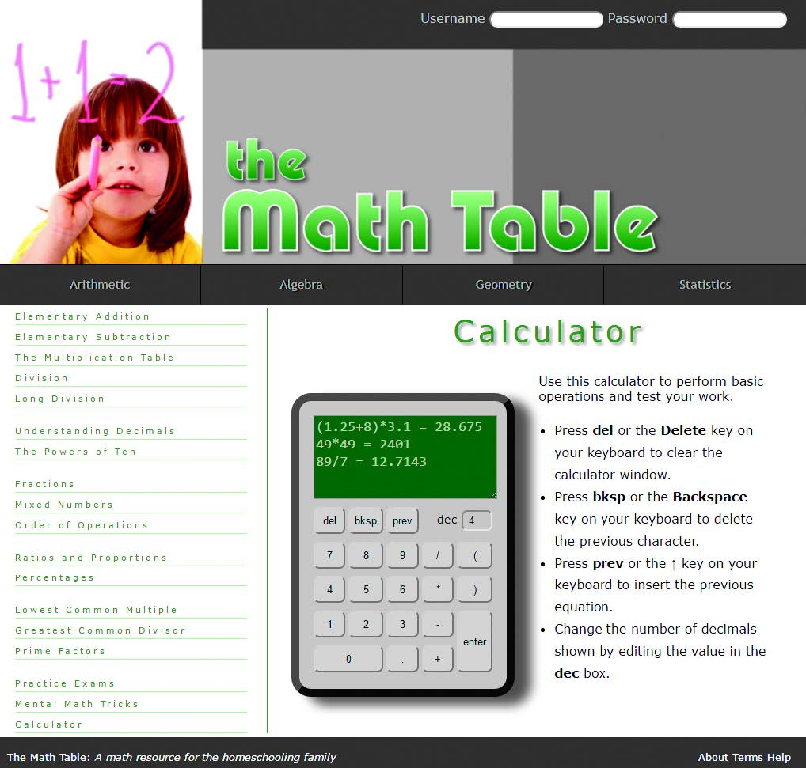

## Summary

**The Math Table** | Theresa Kaine runs The Math Table, a website containing math resources for homeschooling families and educators. Theresa wants to add an online calculator to the site and has asked for your help in designing a simple prototype. A preview of her page is shown in the figure below.

**The Math Table Online Calculator**

The calculator is created using different form widgets. The calculator window is a text area box and
form buttons are used for each of the calculator buttons. The calculator window displays several lines of equations so that students can view multiple equations at once. To use the calculator:

- Enter expressions by clicking the calculator buttons or by typing the expression into the calculator window
- Evaluate an expression by clicking the **enter** button or pressing the **Enter** key
- Clear the calculator window by clicking the **del** button or pressing the **Delete** key
- Remove the last character from an expression by clicking the **bksp** button or pressing the **Backspace** key
- Copy the previous equation listed in the window by clicking the **prev** button or pressing the **uparrow** key on the keyboard
- Change the number of decimal places used in the answer by changing the value in the **dec ** box

To aid you in programming the script for the calculator, Theresa has supplied the following functions:

- `eraseChar(textStr)`, which erases the last character from the text string, `textStr`
- `evalEq(textStr, decimals)`, which evaluates the equation in `textStr`, returning a value to the number of decimals specified by the decimals parameter
- `lastEq(textStr)`, which returns the previous expression from the list of expressions in the `textStr` parameter

Your job will be creating a fully functioning online calculator by adding the event handlers that respond to the user’s mouse and keyboard actions.

## Instructions

This Case Problem contains interactive instructions that you can complete to ensure you've completed the instruction correctly.

After reading each instruction thoroughly, perform the requested change in the code editor to the right. You can use the **Build Website** button to refresh your website preview at any point and view a full-page version of your website by clicking the arrow in the top right corner of your website preview.

After you've completed an instruction, click the corresponding check box in your list of instructions. This will trigger simulated tests of your website to ensure that you successfully completed the instruction.

When you reach the end of the lab, click the **Submit** button to record your score.
