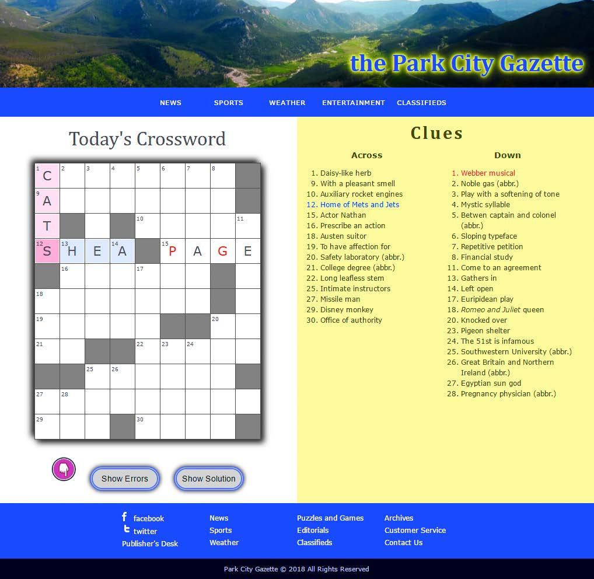

## Summary

**Park City Gazette** | Bernard Mills is a website manager for the Park City Gazette located in Ennis, Montana. He has asked for your help in developing a crossword puzzle page. The puzzle interface should include support for both keyboard and mouse events and provide hints to users about their
mistakes. A preview of the page is shown below.

**Park City Gazette Crossword Puzzle**
The puzzle needs to support the following features:

- Letters are entered from the keyboard in either the horizontal or vertical direction; letters can be removed by pressing either the **Delete** or **Backspace** keys.
- The active cell is highlighted in the puzzle; the across and down cells that intersect with the active cell are also highlighted and the clues associated with the highlighted cells are shown in colored text as well as the clue for that cell and the other letters in the clue answers.
- The user can navigate through the puzzle using either the mouse button or by pressing the **Tab**, **Enter**, and **arrow** keys on the keyboard.
- If the user clicks the **Show Errors** button, any mistakes are briefly displayed in a red font.
- If the user clicks the **Show Solution** button, the puzzle solution is shown.

Bernard has already created a sample puzzle in which each crossword letter is placed within a separate table cell. He has also put information about the puzzle within each cell using the following `data-*` attributes:

- `data-letter` stores the letter for the crossword puzzle solution
- `data-left`, `data-up`, `data-right`, and `data-down` store the `ID`s of the letters to the left, above, to the right, and below the current letter
- `data-clue-a` stores the `ID` of the puzzle clue for the across word
- `data-clue-d` stores the `ID` of the puzzle clue for the down word
  You will use these `data-*` attributes to aid in navigating through the crossword table and checking the user’s solution. Bernard has also created a function named `getChar()` that you will use to retrieve the character corresponding to a key code value.

## Instructions

This Case Problem contains interactive instructions that you can complete to ensure you've completed the instruction correctly.

After reading each instruction thoroughly, perform the requested change in the code editor to the right. You can use the **Build Website** button to refresh your website preview at any point and view a full-page version of your website by clicking the arrow in the top right corner of your website preview.

After you've completed an instruction, click the corresponding check box in your list of instructions. This will trigger simulated tests of your website to ensure that you successfully completed the instruction.

When you reach the end of the lab, click the **Submit** button to record your score.
