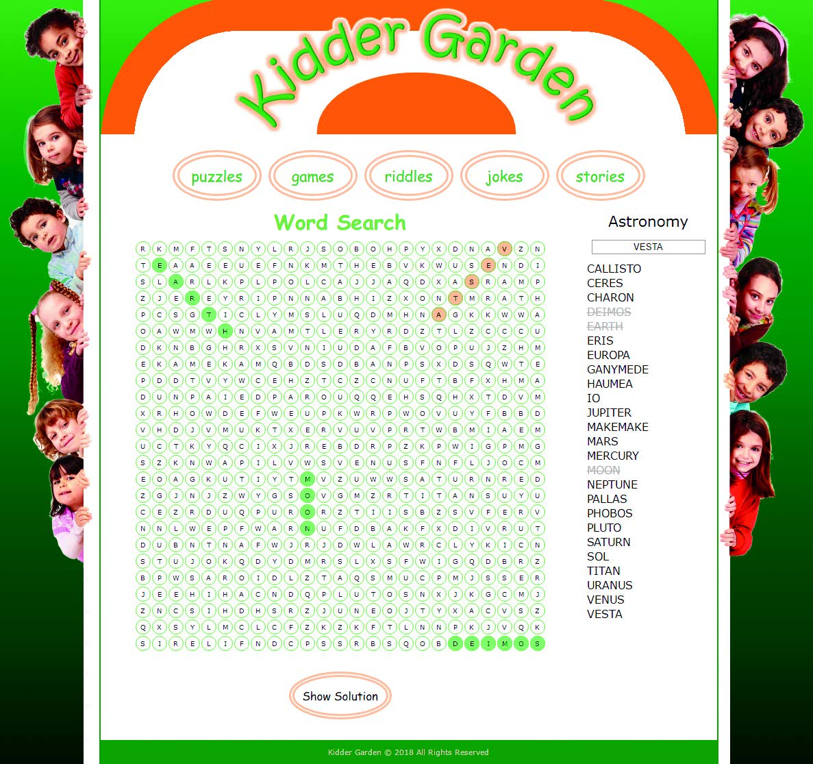

## Summary

**Kidder Garden **| Pete Burnham of the Kidder Garden website has asked for help in developing an interactive word search game. He envisions a page in which children can select letters from the word search table using a mouse pointer. When all the words in the list have been found, a congratulatory message is displayed. A preview of the page is shown below.

  
**Kidder Garden Word Search**

Peter has already provided the style sheet and HTML code for the page. He has also supplied you with the following JavaScript variables:

- A title for the puzzle stored in the `wordSearchTitle` variable
- The word list stored in the `wordArray` variable
- The grid of the puzzle letters stored in the `letterGrid` array
- The grid of the location of words within the puzzle stored in the `wordGrid` array

He has also supplied you with the following functions:

- The `drawWordSearch()` function, which writes the HTML code for a web table with the `ID` `“wordSearchTable”` containing the letters in the word search puzzle. Table cells that contain letters are part of the word list belonging to the `wordCell` class.
- The `showList()` function, which writes the HTML code for an unordered list with the `ID` `“wordSearchList”` containing the words to be found in the puzzle.

Pete wants you to write an app that does the following:

- Writes the HTML code for word search table into the figure element with the ID “wordTable”.
- Writes the HTML code for the word list into the figure element with the ID “wordList”.
- Users select letters by pressing the mouse pointer down and moving over each table cell. As the pointer enters the table cell for the letter, the background color should change to pink and the letter within the cell should be added to text displayed in the `pickedLetter` input box.
- When the mouse button is released, the entry in the `pickedLetter` input box should be checked against the word list. If there is a match, the word is crossed out in the list and the letters selected in the table should change to a light green background.
- If there is no match, the selected letters in the background table should have their background colors removed. After each word selection, the contents of the `pickedLetter` input box should be removed in preparation for the next selection of letters.
- As an aid to the user, the mouse pointer should be displayed using the pointer icon for cells in the word search table. (Note: The pointer looks like a hand with a pointing finger.)
- When moving the mouse pointer over the table cells, the text within those cells should not be selected by the browser.
- Once a letter is displayed with a green background, its background color should never change.
- Once all the words have been found, an alert dialog box should display a congratulatory message to the user.
- The complete list of word locations can be displayed by clicking the "Show Solution" button.

The final form of the solution and your JavaScript program is left to you.

## Instructions

This Case Problem contains interactive instructions that you can complete to ensure you've completed the instruction correctly.

After reading each instruction thoroughly, perform the requested change in the code editor to the right. You can use the **Build Website** button to refresh your website preview at any point and view a full-page version of your website by clicking the arrow in the top right corner of your website preview.

After you've completed an instruction, click the corresponding check box in your list of instructions. This will trigger simulated tests of your website to ensure that you successfully completed the instruction.

When you reach the end of the lab, click the **Submit** button to record your score.
