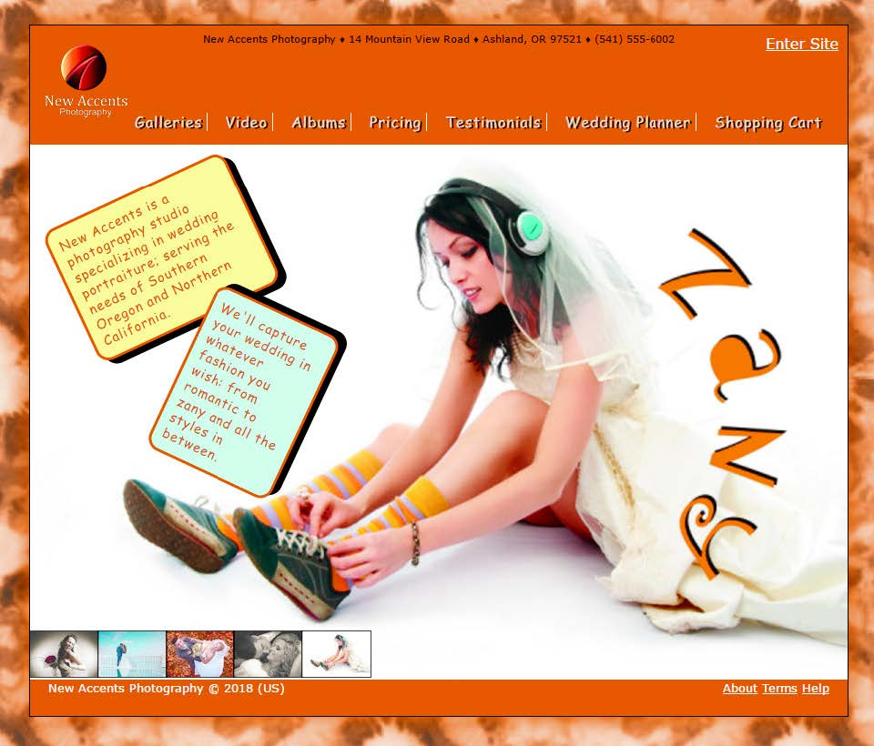

## Summary

**New Accents Photography**| Christine Drake is the owner and chief photographer at New Accents Photography, a photography studio in Ashland, Oregon, that specializes in wedding photos. Wedding portraiture is a competitive business, and Christine wants to improve the design of her website’s opening page. Christine is proud of the many and varied styles of portraiture that New Accents Photography offers, and she would like to create an interactive style sheet switcher that loads different style designs selected by the user. Christine wants your help with writing a JavaScript app that examines the list of style sheets in the site’s home page and creates a figure box of clickable thumbnail images for each
sheet design. A preview of the page you will create for Christine is shown in _Figure 12-54_ below.

 
**Figure 12-54 Styles for New Accents Photography**

## Instructions

This Case Problem contains interactive instructions that you can complete to ensure you've completed the instruction correctly.

After reading each instruction thoroughly, perform the requested change in the code editor to the right. You can use the **Build Website** button to refresh your website preview at any point and view a full-page version of your website by clicking the arrow in the top right corner of your website preview.

After you've completed an instruction, click the corresponding check box in your list of instructions. This will trigger simulated tests of your website to ensure that you successfully completed the instruction.

When you reach the end of the lab, click the **Submit** button to record your score.
