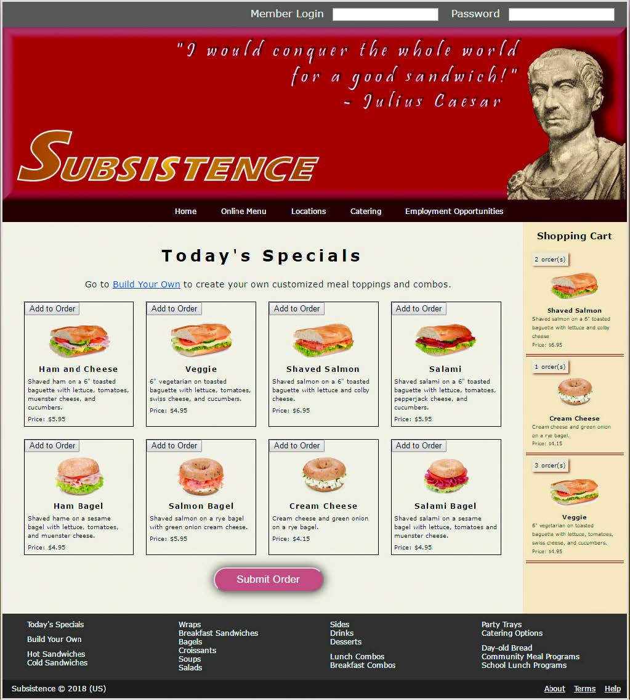

## Summary

**Subsistence** | Maria Torres manages the website for Subsistence, a popular chain of sandwich shops located in southern Indiana. She has asked you to work on the interface for the store’s shopping cart. Maria has supplied you with a web page highlighting the store’s daily specials. She would like customers to be able to add items to the shopping cart by clicking a button next to the item description; once the button is clicked, then the description and image are added to a shopping cart panel located on the right side of the page. The shopping cart should keep a running total of the number of each item ordered. _Figure 12-55_ below shows a preview of the page you will work on for Maria.

 

**Figure 12-55 Subsistence shopping cart items**

## Instructions

This Case Problem contains interactive instructions that you can complete to ensure you've completed the instruction correctly.

After reading each instruction thoroughly, perform the requested change in the code editor to the right. You can use the **Build Website** button to refresh your website preview at any point and view a full-page version of your website by clicking the arrow in the top right corner of your website preview.

After you've completed an instruction, click the corresponding check box in your list of instructions. This will trigger simulated tests of your website to ensure that you successfully completed the instruction.

When you reach the end of the lab, click the **Submit** button to record your score.
