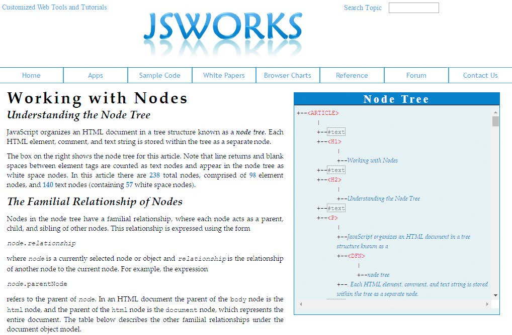

## Summary

**JSWorks**| Jorge Soto is the owner and administrator of JSWorks, a website containing JavaScript tutorials, tips, and specialized apps. Jorge is working on a multipage tutorial concerning the creation and use of document nodes. You are helping Jorge maintain his website and have volunteered to work on a page describing the appearance of the document node tree. Jorge would like you to include a node tree that is based on the article he is writing so that visitors to his site can see the complete appearance of the node tree for a sample HTML fragment. _Figure 12-56_ below shows a preview of the page.

  

**Figure 12-56Node Tree Diagram for JSWorks**

The JavaScript program you will design will need to use recursion to navigate through the entire structure of Jorge’s article. As it proceeds through the article, it will record each element node and text node, displaying them in a nested list alongside the article text. The CSS styles for the nested list already have been created for you; your only job will be to generate the HTML code of the nested
list. Jorge also wants your code to keep a running count of the total number of element and text nodes, including text nodes containing only white space.

## Instructions

This Case Problem contains interactive instructions that you can complete to ensure you've completed the instruction correctly.

After reading each instruction thoroughly, perform the requested change in the code editor to the right. You can use the **Build Website** button to refresh your website preview at any point and view a full-page version of your website by clicking the arrow in the top right corner of your website preview.

After you've completed an instruction, click the corresponding check box in your list of instructions. This will trigger simulated tests of your website to ensure that you successfully completed the instruction.

When you reach the end of the lab, click the **Submit** button to record your score.
