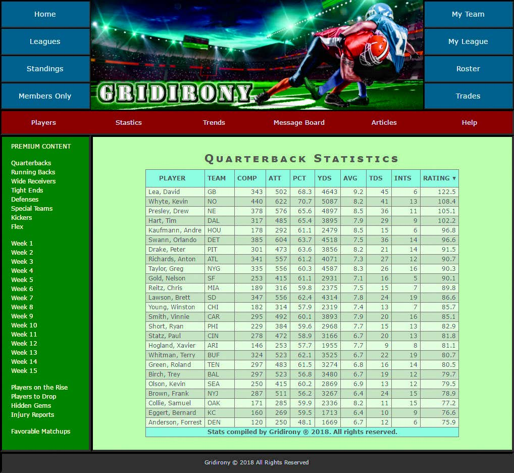

## Summary

**Gridirony** | Jeremy Howard is the owner and operator of the fantasy football website, Gridirony. The Gridirony website provides a gaming environment for fantasy football players, including pages and pages of in-depth statistics and analysis. Much of Gridirony’s data is arranged in tables and Jeremy wants an app that will turn any of his web tables into a sortable table in which users can sort the table data in ascending or descending order by clicking a table column heading. _Figure 12-57_ below shows a preview of a table in which the quarterback statistics are sorted in descending order by the quarterback rating.

**Figure 12-57 Sortable Web Table for Gridirony**

Jeremy has already written the HTML and CSS code for the page, but he wants your help in writing the JavaScript code to create the sortable table app.

## Instructions

This Case Problem contains interactive instructions that you can complete to ensure you've completed the instruction correctly.

After reading each instruction thoroughly, perform the requested change in the code editor to the right. You can use the **Build Website** button to refresh your website preview at any point and view a full-page version of your website by clicking the arrow in the top right corner of your website preview.

After you've completed an instruction, click the corresponding check box in your list of instructions. This will trigger simulated tests of your website to ensure that you successfully completed the instruction.

When you reach the end of the lab, click the **Submit** button to record your score.
