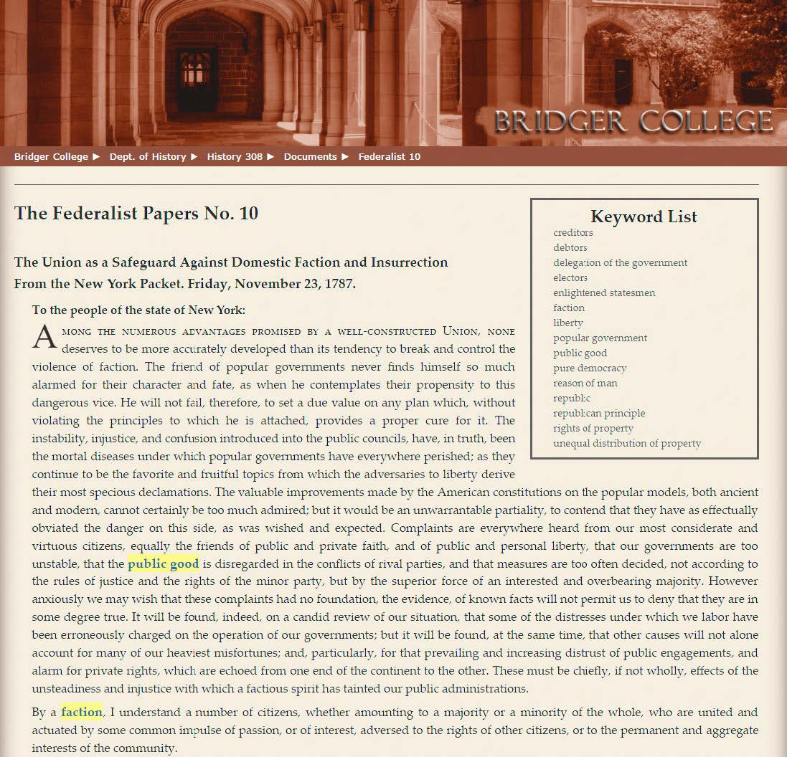

<!--manual-->

## Summary

Many of Norene’s documents have essential keywords that highlight important ideas and themes. Norene has marked these keywords with a `dfn` (definition) element. She wants you to create an app that searches the document text and locates these keywords and lists them in a keyword box displayed alongside the document. The entries in the keyword box should be inserted as hypertext,
linked to that section of the document where the keyword is used. The display styles for the keyword box will be entered as part of the JavaScript program. _Figure 12-53_ below shows a preview of the page created for the tenth Federalist paper written by James Madison in 1787 on the danger of factions to the
republic.

**Figure 12-53 Keyword List for the Federalist 10 article**

## Instructions

This Review Assignment contains interactive instructions that you can complete to ensure you've completed the instruction correctly.

After reading each instruction thoroughly, perform the requested change in the code editor to the right. You can use the **Build Website** button to refresh your website preview at any point and view a full-page version of your website by clicking the arrow in the top right corner of your website preview.

After you've completed an instruction, click the corresponding check box in your list of instructions. This will trigger simulated tests of your website to ensure that you successfully completed the instruction.

When you reach the end of the lab, click the **Submit** button to record your score.
