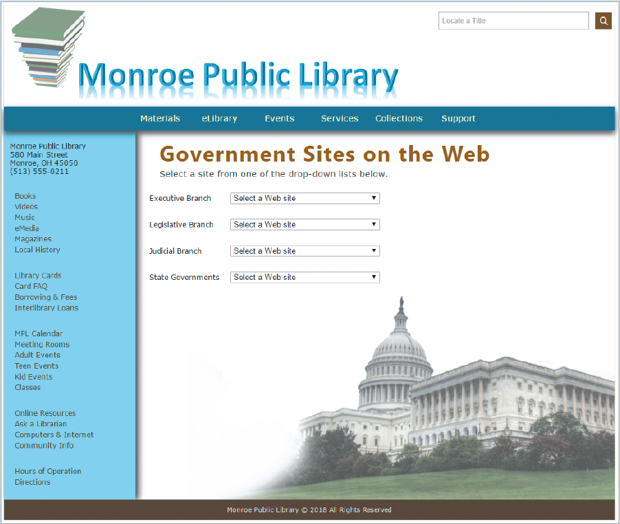

## Summary

**_Monroe Public Library_** Denise Kruschev manages the website for the Monroe Public Library in Monroe, Ohio. One of her responsibilities is to add content and links to the site that will be of interest to the library’s patrons. Denise has asked you to create a web page containing links to hundreds of government websites. She knows that a long list of links will fill the page, making navigation within the page difficult.

Denise wants to use “select and go” navigation in which the links are placed within a selection list. When a patron selects a website from the list, the linked site should open automatically. Denise has already set up the selection list and the URLs for each government site; she wants you to write the JavaScript code to load the website chosen via the selection list. Figure 13-64 shows a preview of the web page you will create.

## Instructions ##
This Case Problem contains interactive instructions that you can complete to ensure you've completed the instruction correctly.

After reading each instruction thoroughly, perform the requested change in the code editor to the right. You can use the **Build Website** button to refresh your website preview at any point and view a full-page version of your website by clicking the arrow in the top right corner of your website preview.

After you've completed an instruction, click the corresponding check box in your list of instructions. This will trigger simulated tests of your website to ensure that you successfully completed the instruction.

When you reach the end of the lab, click the **Submit** button to record your score.
