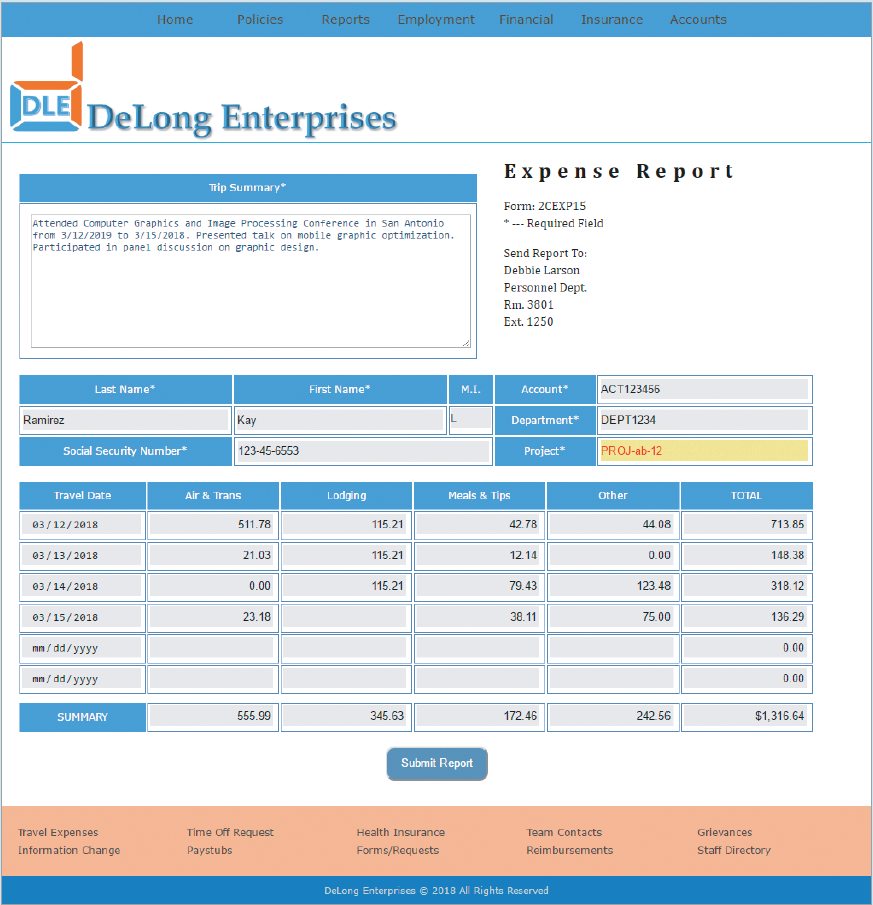

## Summary

**_DeLong Enterprises_** Kay Ramirez is a human resources manager at DeLong Enterprises, a manufacturer of computer components and digital equipment located in Plano, Texas. The company has been busy putting corporate information on the company’s intranet.

Kay is heading a project to put all payroll-related forms and reports online. She asks you to help write a program for an online travel expense form. The form requires employees to list their various travel expenses for corporate-sponsored trips.

Kay wants a script added to the form to ensure that all the required data is entered in the correct format. She also wants the form to automatically total the expense costs for transportation, lodging, meals, and other miscellaneous items for each travel day for the entire trip. A preview of the page is shown in Figure 13-65.

**Figure 13-65. DeLong Enterprises travel expense report**

## Instructions

This Case Problem contains interactive instructions that you can complete to ensure you've completed the instruction correctly.

After reading each instruction thoroughly, perform the requested change in the code editor to the right. You can use the **Build Website** button to refresh your website preview at any point and view a full-page version of your website by clicking the arrow in the top right corner of your website preview.

After you've completed an instruction, click the corresponding check box in your list of instructions. This will trigger simulated tests of your website to ensure that you successfully completed the instruction.

When you reach the end of the lab, click the **Submit** button to record your score.
