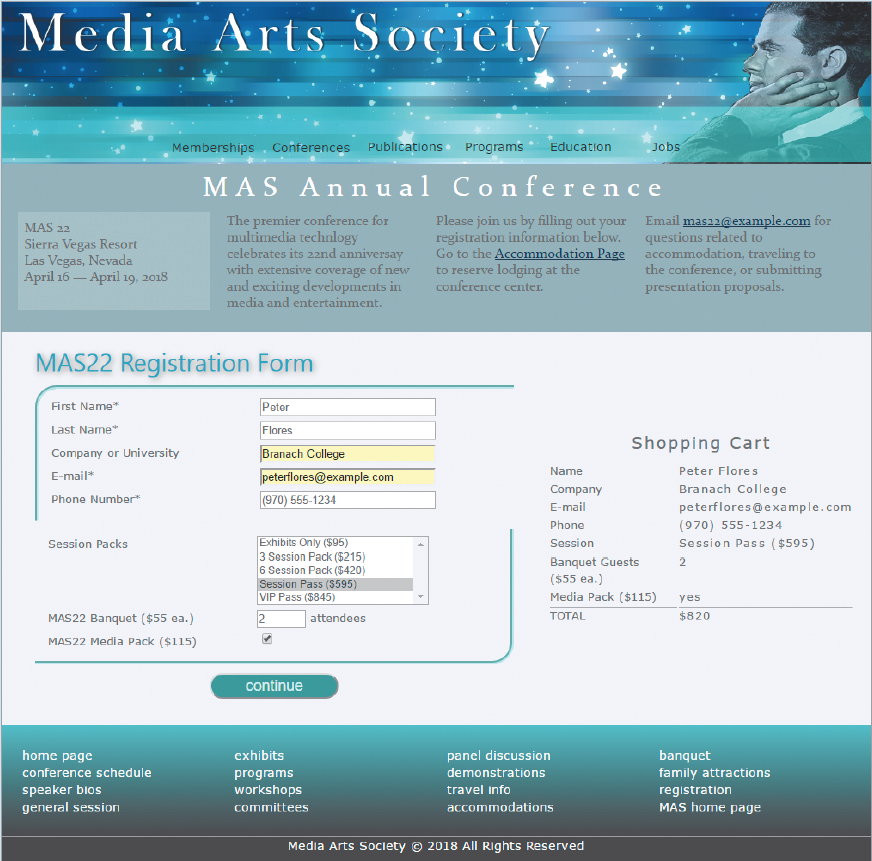

## Summary

**_Media Arts Society_** Gary Unwin manages promotion for the Media Arts Society annual conference – a popular conference for people who develop multimedia applications and technology. He has asked you to work on the conference website.

One of your first jobs will be to work on the registration page. You will start by designing the page in which conference-goers enter their contact information and choose which session packages to purchase. Figure 13-66 shows a preview of the page you will create.

**Figure 13-66. Media Arts Society registration page**

To create this page, you will save the choices of the user in session storage variables and then display those values and their totals on the right side of the page. You will also use those session storage variables in another page in the MAS conference website.

## Instructions

This Case Problem contains interactive instructions that you can complete to ensure you've completed the instruction correctly.

After reading each instruction thoroughly, perform the requested change in the code editor to the right. You can use the **Build Website** button to refresh your website preview at any point and view a full-page version of your website by clicking the arrow in the top right corner of your website preview.

After you've completed an instruction, click the corresponding check box in your list of instructions. This will trigger simulated tests of your website to ensure that you successfully completed the instruction.

When you reach the end of the lab, click the **Submit** button to record your score.
