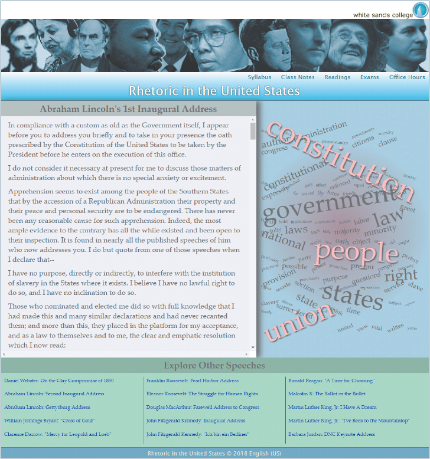

## Summary

**_Rhetoric in the United States_** Professor Annie Cho, who teaches rhetoric and history at White Sands College, wants your help in developing her website on great American speeches. She has asked you to create a word cloud of Abraham Lincoln's first inaugural address.

A **word cloud** is a chart of several words, in which each word's size is based on the frequency of use in a selected text. Word clouds highlight the most important themes and concepts in the given text. A preview of the word cloud for Lincoln's first inaugural address is shown in Figure 13-67.

**Figure 13-67. Word cloud of Lincoln's first inaugural address**

By viewing the word cloud, it is clear to Professor Cho's students that the first inaugural address was primarily focused on government and constitutional issues, while topics such as slavery and war were not as prominent.

To create a word cloud, you will work with the JavaScript methods and properties for manipulating text strings. You will also work with regular expressions to remove commonly used words such as "it" or "this", also known as **stop words**.

Professor Cho has provided you with an array of stop words as well as some JavaScript functions that will aid you in writing the word cloud code.

## Instructions

This Case Problem contains interactive instructions that you can complete to ensure you've completed the instruction correctly.

After reading each instruction thoroughly, perform the requested change in the code editor to the right. You can use the **Build Website** button to refresh your website preview at any point and view a full-page version of your website by clicking the arrow in the top right corner of your website preview.

After you've completed an instruction, click the corresponding check box in your list of instructions. This will trigger simulated tests of your website to ensure that you successfully completed the instruction.

When you reach the end of the lab, click the **Submit** button to record your score.
