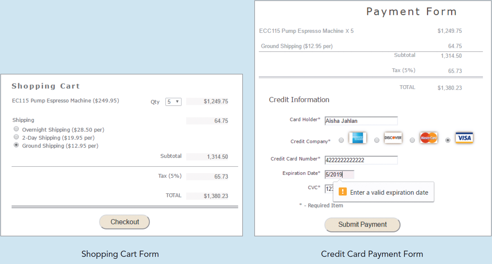

<!--manual-->

## Summary

Aisha wants you to work on another version of the shopping cart and payment pages. As with the version you completed in this tutorial, she wants you to add code to the shopping cart page that calculates the total cost of the order and transfers that data to the credit card payment page when the shopping cart form is submitted.

On the credit card payment page, she wants to display the contents of the order and provide validation checks for the credit card payment.

Figure 13-63 (below) shows a preview of the forms on the two pages. Some of the code for both pages have already been created for you. Your job will be to finish the code.

**Figure 13-63. Espresso machine order.**

## Instructions

This Review Assignment contains interactive instructions that you can complete to ensure you've completed the instruction correctly.

After reading each instruction thoroughly, perform the requested change in the code editor to the right. You can use the **Build Website** button to refresh your website preview at any point and view a full-page version of your website by clicking the arrow in the top right corner of your website preview.

After you've completed an instruction, click the corresponding check box in your list of instructions. This will trigger simulated tests of your website to ensure that you successfully completed the instruction.

When you reach the end of the lab, click the **Submit** button to record your score.
