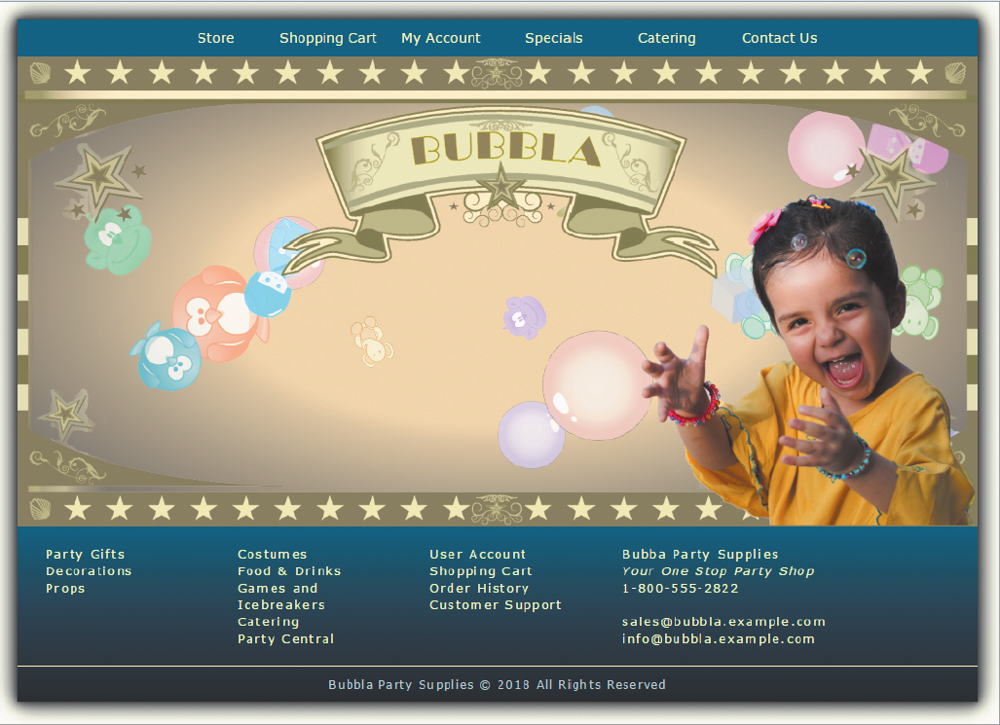

## Summary

**_Bubbla Party Supplies_** Drew Evans is a manager at Bubbla Party Supplies, a company that specializes in party favors, decorations, and costumes. He’s asked you to work on the home page for the company website. Drew would like to add some fun bubble shapes to the company logo that appear to drift, bounce, spin and change hue. You can create these effects using custom objects in JavaScript. A preview of the home page is shown in Figure 14-47.

**Figure 14-47. Bubbla Party Supplies home page**

To create the animated bubbles, you will create a custom class of "bubble" objects that contains several useful properties such as a bubble’s position and velocity on the page, its speed of rotation, and its hue. You will also create an effect that makes the bubbles bounce off the "walls" of the container.

## Instructions

This Case Problem contains interactive instructions that you can complete to ensure you've completed the instruction correctly.

After reading each instruction thoroughly, perform the requested change in the code editor to the right. You can use the **Build Website** button to refresh your website preview at any point and view a full-page version of your website by clicking the arrow in the top right corner of your website preview.

After you've completed an instruction, click the corresponding check box in your list of instructions. This will trigger simulated tests of your website to ensure that you successfully completed the instruction.

When you reach the end of the lab, click the **Submit** button to record your score.
