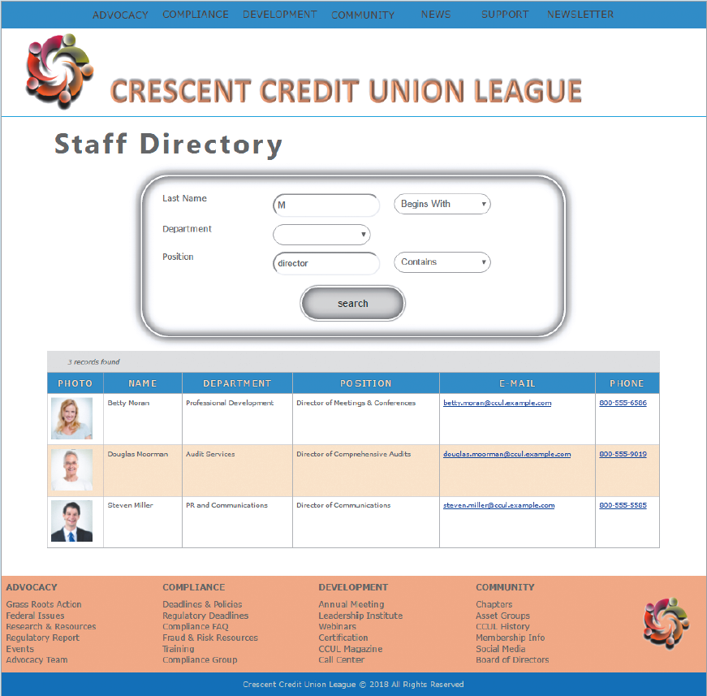

## Summary

**_Crescent Credit Union League_** Richard Coates is the IT manager at the Crescent Credit Union League (CCUL), an advocacy group for credit unions providing a political voice for credit unions and offering education and training for CCUL members. Richard wants you to work on the CCUL’s staff directory page for its website. He wants users to be able to search the directory, retrieving contact information for specific employees at CCUL.

The staff directory is stored in an object literal named "staff" that contains a single object named "directory". The directory object contains an array of objects that displays each employee's id, first and last name, position, department, e-mail address, phone number, and image file.

Your job is to create a search tool that searches the staff object directory array for employees whose last name, position, and/or department matches the user's search conditions. A preview of the page you will create is shown in Figure 14-48.

**Figure 14-48. Crescent Credit Union League**

## Instructions

This Case Problem contains interactive instructions that you can complete to ensure you've completed the instruction correctly.

After reading each instruction thoroughly, perform the requested change in the code editor to the right. You can use the **Build Website** button to refresh your website preview at any point and view a full-page version of your website by clicking the arrow in the top right corner of your website preview.

After you've completed an instruction, click the corresponding check box in your list of instructions. This will trigger simulated tests of your website to ensure that you successfully completed the instruction.

When you reach the end of the lab, click the **Submit** button to record your score.
