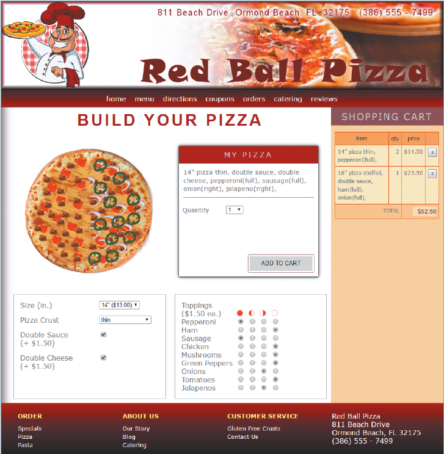

## Summary

**_Red Ball Pizza_** Alice, Nichols, the manager at Red Ball Pizza, in Ormond Beach, Florida, wants to add online ordering to the store's website. She's asked your help in writing the code for a page in which customers can select options from a web form to create a custom pizza and add their selections to a shopping cart.

As they select what to put on the pizza, a preview of the completed pizza appears on the webpage. A preview of the page is shown in Figure 14-49.

**Figure 14-49. Build a pizza at Red Ball Pizza**

Alice has already designed the page and included some of the code for the webpage. Your job will be to complete the programming by adding custom objects, properties, and methods for the pizza and the shopping cart.

## Instructions

This Case Problem contains interactive instructions that you can complete to ensure you've completed the instruction correctly.

After reading each instruction thoroughly, perform the requested change in the code editor to the right. You can use the **Build Website** button to refresh your website preview at any point and view a full-page version of your website by clicking the arrow in the top right corner of your website preview.

After you've completed an instruction, click the corresponding check box in your list of instructions. This will trigger simulated tests of your website to ensure that you successfully completed the instruction.

When you reach the end of the lab, click the **Submit** button to record your score.
