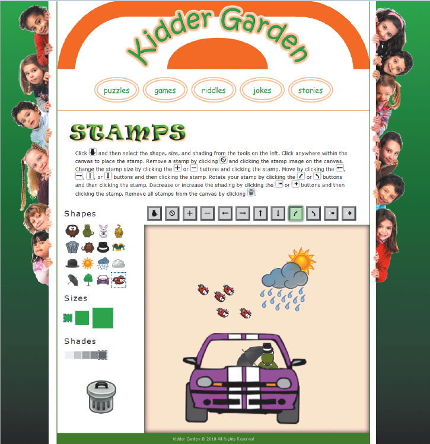

## Summary

**_Kidder Garden_** Pete Burnham of the Kidder Garden website wants you to develop an application for drawing images or "stamps". As a proof of concept, he wants you to create a webpage in which users can choose stamps of a specified size and shade (opacity) and then place those stamp images on a canvas using the mouse.

The user can then modify the size, position, rotation, or shading (opacity) by clicking tools from a toolbar and applying that tool to a stamp image. Pete has already designed the webpage. He needs you to write the code to create the stamp objects and place them as images on the page's canvas. Figure 14-50 shows a preview of a completed page with stamp images created and modified by the user.

**Figure 14-50. Stamps game at Kidder Garden**

Pete has also supplied you with the following object methods that will be useful to you:

- The `elementX()` method for the `Event` object prototype that returns the x-coordinate of a mouse click event occurring within an element.
- The `elementY()` method for the `Event` object prototype that returns the y-coordinate of a mouse click event occurring within an element.
- The `removeChildren()` method that removes all child nodes from an element.

The final form of the code is up to you and may include enhancements that you think will add to the value of the final application, but it must include the following:

- An interface that shows the currently selected shape, size, and shading (opacity) controls and the currently selected tool from the toolbar.
- A custom `stamp` object that stores the `shape`, `size`, and `shade` (opacity) of a stamp.
- A custom `game` object that stores the current control and tool option selected by the user and includes an array named `stamps` that stores all stamp objects created by the user.
- A custom method named `addToGame` defined as a prototype for the class of `stamp` objects to add the `stamp` to the `stamps` array within the `game` object.
- A custom method named `removeStamps` defined as a prototype for the class of `game` objects to empty out the `game` object's `stamps` array.
- Functions to place stamp images on the page canvas at the location of the user's mouse click and add the stamp object to the game object's stamps array.
- Functions to modify the stamp image's size, position, rotation, and shading when the image is clicked by the user. Another function to remove the stamp image when clicked by the user and to remove the stamp object from the game object's stamps array.
- A function that removes all stamp images from the canvas and all stamp objects from the game object's stamps array, when the user clicks the garbage can icon.

## Instructions

This Case Problem contains interactive instructions that you can complete to ensure you've completed the instruction correctly.

After reading each instruction thoroughly, perform the requested change in the code editor to the right. You can use the **Build Website** button to refresh your website preview at any point and view a full-page version of your website by clicking the arrow in the top right corner of your website preview.

After you've completed an instruction, click the corresponding check box in your list of instructions. This will trigger simulated tests of your website to ensure that you successfully completed the instruction.

When you reach the end of the lab, click the **Submit** button to record your score.
