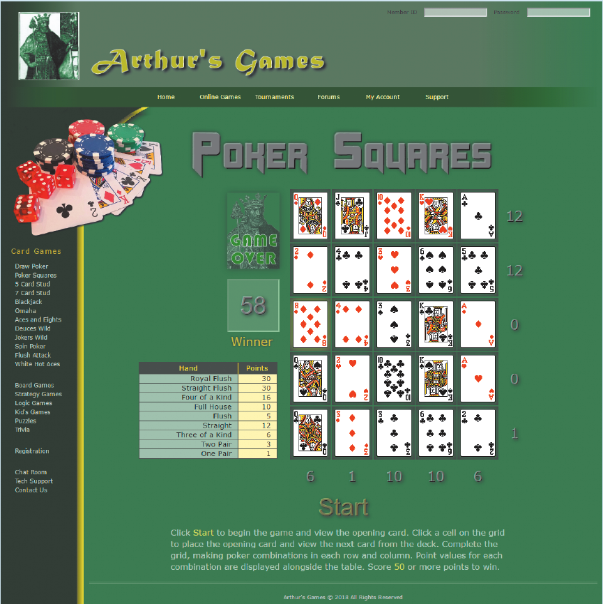

<!--manual-->

## Summary

After your work on the Draw Poker game, Bob wants you to work on programming the page for the Poker Squares game. Poker Squares is played on a 5×5 grid in which players place a card from the deck on one of 25 grid cells. When all 25 cells are filled, five rows and five columns of poker hands are evaluated. Points are given for the following hands:

- Royal Flush (30 pts)
- Straight Flush (30 pts)
- Four of Kind (16 pts)
- Full House (10 pts)
- Flush (5 pts)
- Straight (12 pts)
- Three of a Kind (6 pts)
- Two Pair (3 pts)
- One Pair (1 pt)

A winning grid has ten hands totaling 50 points or more. Bob has created the page design and made available many of the custom objects and methods you developed for the Draw Poker game. Your task will be to complete the application by writing the code for the game interface and providing methods to evaluate the hands in each row and column, as well as calculate the final game total.

Because the cards are laid out in a grid, your code will store pokerHand objects in a 2-dimensional array named cardGrid. Each item of the cardGrid array will contain a single pokerHand object and each hand object will contain a cards array consisting of 5 pokerCard objects.
A preview of a completed page is shown in Figure 14-46.

**Figure 14-46. Poker Squares game**

## Instructions

This Review Assignment contains interactive instructions that you can complete to ensure you've completed the instruction correctly.

After reading each instruction thoroughly, perform the requested change in the code editor to the right. You can use the **Build Website** button to refresh your website preview at any point and view a full-page version of your website by clicking the arrow in the top right corner of your website preview.

After you've completed an instruction, click the corresponding check box in your list of instructions. This will trigger simulated tests of your website to ensure that you successfully completed the instruction.

When you reach the end of the lab, click the **Submit** button to record your score.
